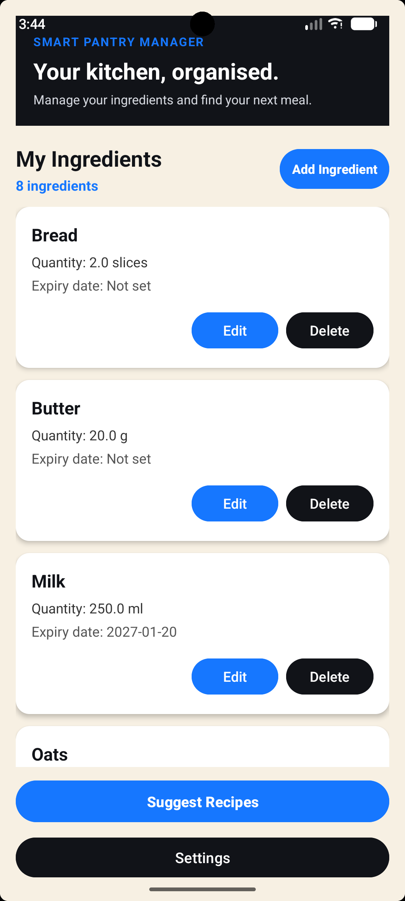
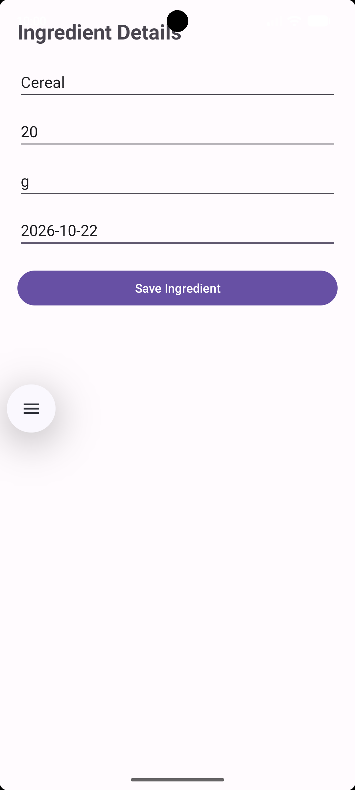
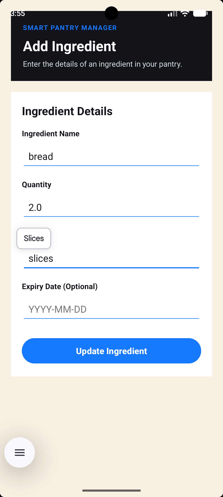
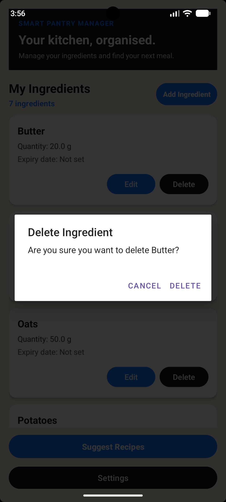
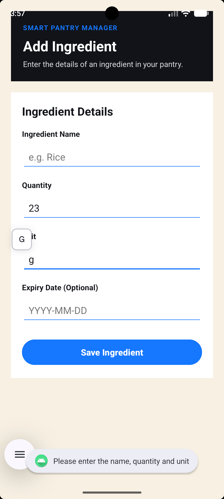
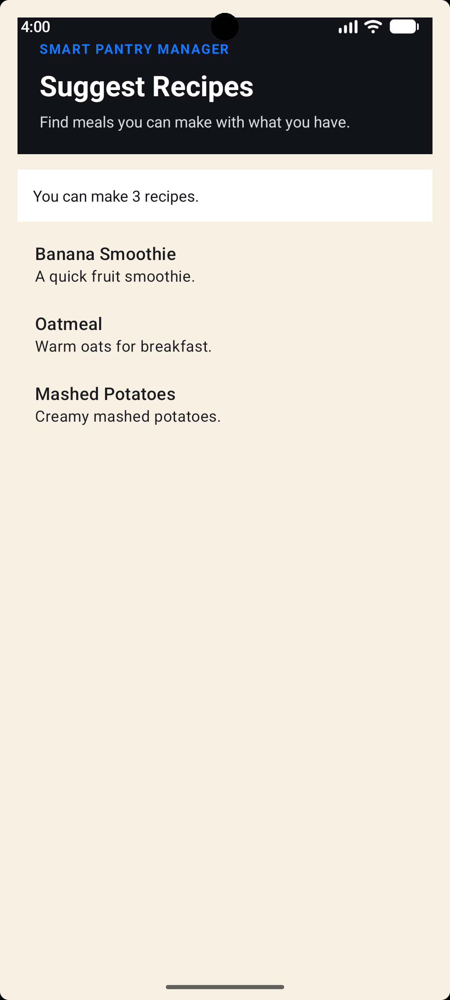
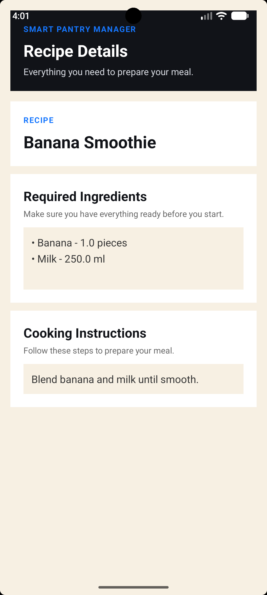
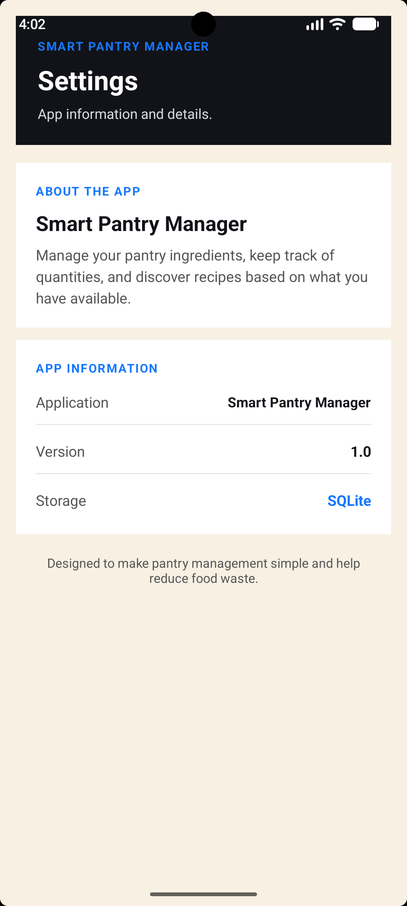

Smart Pantry Manager 

Introduction
Smart Pantry Manager is an Android application that was developed to help users keep track of the ingredients they
have at home. It allows users to manage their pantry items and find recipes based on what they already have available.
The main idea behind the app is to make it easier to plan meals and reduce food waste by using ingredients that are 
already in the pantry. The application was developed using Java in Android Studio, with SQLite being used to store the
pantry information locally on the device.

Main Features
The application includes the following features:
Pantry Management: Users can add, edit and delete ingredients, including details such as the ingredient name, quantity
, unit and expiry date.
Local Database: SQLite is used to save ingredient information, which means that the data is still available when the 
user closes and reopens the app.
Ingredient List: The pantry items are displayed using RecyclerView and a custom adapter, which helps organise the
information on the screen.
Recipe Suggestions: The app checks the ingredients in the pantry and suggests recipes that the user can make with what
they have available.
Recipe Details: Users can select a suggested recipe to view its required ingredients and cooking instructions.
Strict Ingredient Matching: A recipe is only suggested when all its required ingredients are available in sufficient
quantities. This helps make sure that the suggested recipes are actually possible to prepare with the ingredients in
the pantry.
Settings: The app includes a Settings screen where users can view basic information about the application.

Technologies Used
The technologies  to create the application are :
Java: Used to implement the application logic and connect the different screens.
Android Studio: Used as the main development environment.
SQLite: Used for storing pantry ingredients in a local database.
RecyclerView and Custom Adapter: Used to display pantry ingredients and recipe suggestions in an organised list.
Activities and Intents: Used to manage navigation between the different screens.
Git and GitHub: Used to track code changes and keep an online copy of the project during development.

Database Design
The application uses SQLite to store pantry ingredients locally on the device. Each ingredient contains an ID, name, 
quantity, unit and expiry date. The ID is used to identify individual records when ingredients are edited or deleted.
Using a local database means that users do not have to enter their pantry information every time they open the 
application. The database also supports the main CRUD operations, which are Create, Read, Update and Delete.

Recipe Matching
The recipe matching feature compares the ingredients required by each recipe with the items stored in the user's pantry. 
It checks whether every required ingredient is present and whether the available quantity is enough. If an ingredient is 
missing or the quantity is not sufficient, that recipe is excluded from the suggestions. This is important because the app 
should only recommend recipes that the user can make with their current ingredients.

How to Run the Application
Clone or download the project from the GitHub repository.
Open the project in Android Studio.
Allow Gradle to sync and resolve the project dependencies.
Start an Android emulator or connect a compatible Android device.
   
Run the application from Android Studio.
Project Purpose
This project was developed for the Mobile App Development 700 assignment. It applies Android development concepts such as 
database management, user interface design, navigation between activities and working with lists using RecyclerView.
The project also demonstrates how application logic can be used to solve a practical problem, which is helping users manage
their pantry ingredients and identify recipes they can prepare with what they have available.

Screenshots 
The following screenshots  will show the main features and screens of this   Smart Pantry Manager  application.
1. Ingredient list

2. Add ingredient

3. Edit ingredient

 

4. Delete Confirmation

5. Validation error

6. Suggested Recipes

7. Recipe Details

8.Settings

